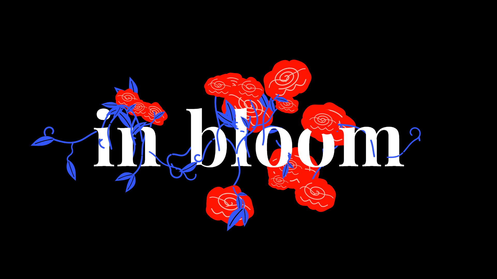
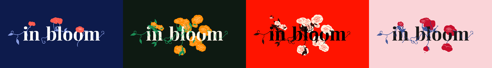

# Type Garden — a single-file rebuild

> **This is an adaptation of [Type Garden](https://type-garden.vercel.app) by [Akshat Agarwal](https://x.com/art_akshat).**
> The idea, the look and the drawing and motion code are his: stems and roses that grow out of the letters as you type,
> space cutting the stems, backspace withering them, the poster loops and the palettes. This repository rebuilds that
> work as one self-contained HTML file and adds a wallpaper mode. If you like it, try the original and consider
> [supporting Akshat](https://buymeacoffee.com/akshatagarwal).

## Use it

**Try it live: [pavankumar-dss.github.io/type-garden](https://pavankumar-dss.github.io/type-garden/)**

Or download [`index.html`](index.html) and open it in a browser. No install, no build step. It needs an internet
connection the first time only to load the fonts from Google Fonts.

It has three modes, switched at the top right:

| Mode | What it does |
|---|---|
| **Type** | Type to grow a garden. Space cuts the stems so the next word grows its own garden, backspace withers, enter clears. Double-click plants a rose, clicking calls a butterfly. Save as PNG or SVG (Ctrl/⌘+S, Shift for SVG). |
| **Poster** | 1:1 motion loops (Breathe, Grow & wither, Typed, Gust, Reach, Scatter, Visitor) in ten palettes, exported as an MP4/WebM loop or as PNG frames. |
| **Wallpaper** | One seamless desktop loop that runs through every motion and palette, exported as MP4 at 1080p, 1440p, 4K or phone size, 60 and/or 30 fps. *(added in this version)* |

### Wallpaper mode

The wallpaper opens and closes on **Typed**: the words are typed out, then the loop travels through the other motions
and palettes and finally erases the words, ending on the empty caret it started from, so it loops with no visible seam.

Every motion grows the *same* garden (same words, same seed), so the hand-overs are matched rather than crossfaded:

- Where two motions' gardens are identical (Typed's hold, Grow & wither and Scatter in full bloom) the hand-over is an
  exact cut and only the colours change.
- Elsewhere the garden's points slide the last few pixels from one motion's pose into the next, so there is only ever
  one crisp garden on screen. Breathe never stands still, so its hand-overs slide a little further.
- Palettes blend in OKLab, and the hand-drawn "boil" runs on one shared clock across segments.
- In the wallpaper, Reach follows a small bee instead of a dot of light (a checkbox switches it back).

The sequence (palette, motion and repeats for each segment) can be edited, and each row shows how well it hands over
to the next. **Reset to preset** brings back the default loop. Bigger sizes draw the 1080p design scaled up, so a 4K
export moves exactly like the 1080p one.

Export encodes H.264 in the browser with WebCodecs and writes the MP4 directly. Chrome and Edge support it, and so do
recent Firefox versions.

### `wallpaper/`: the ffmpeg route (optional)

The same builder as a separate page that renders every frame to PNG and encodes with ffmpeg. The files come out
smaller for the same quality. It needs Python and ffmpeg on your PATH: double-click `wallpaper/start-wallpaper.cmd`
on Windows (or run `py wallpaper/server.py --open`) and use the page it opens.

## What changed from the original

- **One plain HTML file** instead of a Claude Design component: canvas and vanilla JavaScript, no framework or build.
- **Typeface:** the original uses GT Ultra Fine, a commercial font. This version uses
  [Playfair Display](https://fonts.google.com/specimen/Playfair+Display) Bold for the letters and
  [DM Mono](https://fonts.google.com/specimen/DM+Mono) for the interface (both SIL Open Font License, via Google Fonts).
- **Visitor poster loop:** the butterfly picks its two landing roses once per loop (they used to be re-picked every
  frame, so it jumped between roses that sat close together), takes off and lands with eased motion, and visits the
  two roses furthest apart.
- **Typed poster loop:** 6 s, with 1.5 s of typing, a 3 s hold and 1.5 s of deleting.
- **Poster export names** include the motion and palette, e.g. `garden-in-bloom-breathe-rosenoir.mp4`.
- **Wallpaper mode**, described above.
- **Not included:** the live "other gardeners" cursors, which need the original's Supabase backend. Double-click
  still plants a rose, but only on your own screen. SVG export keeps letters as live text in Playfair Display, since
  the original's glyph-outline data isn't available.

## Credits and license

- **Type Garden**: concept, design and original code by **Akshat Agarwal**:
  [type-garden.vercel.app](https://type-garden.vercel.app) · [@art_akshat](https://x.com/art_akshat) ·
  [Buy him a coffee](https://buymeacoffee.com/akshatagarwal).
- This adaptation was made from the code Akshat shares on the original site.
- **Fonts**: Playfair Display and DM Mono, SIL Open Font License, served by Google Fonts.

The original Type Garden does not publish a license, so this repository doesn't grant one either: the original work
remains Akshat Agarwal's. Please credit him if you share or build on this, and ask him before any commercial use.
